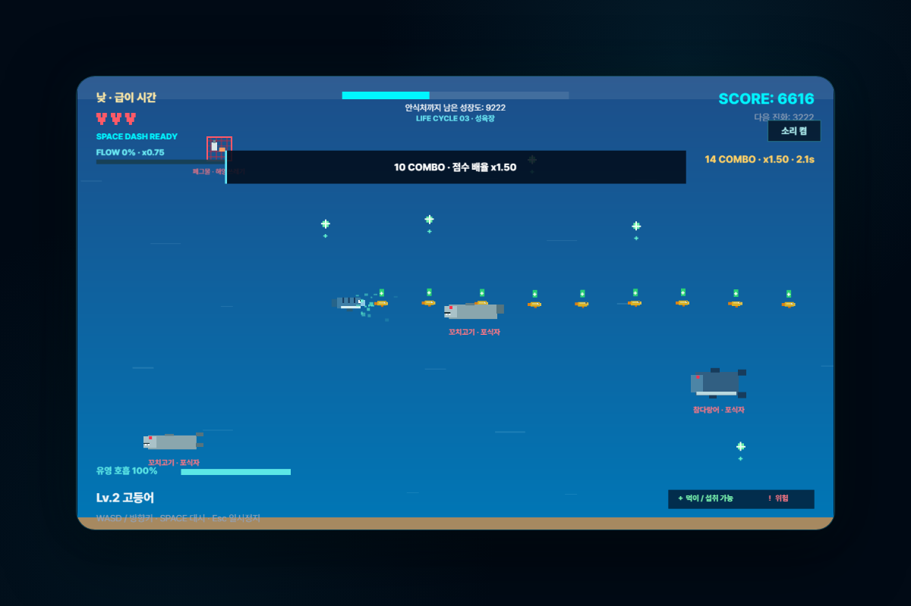
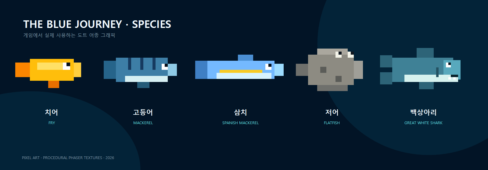
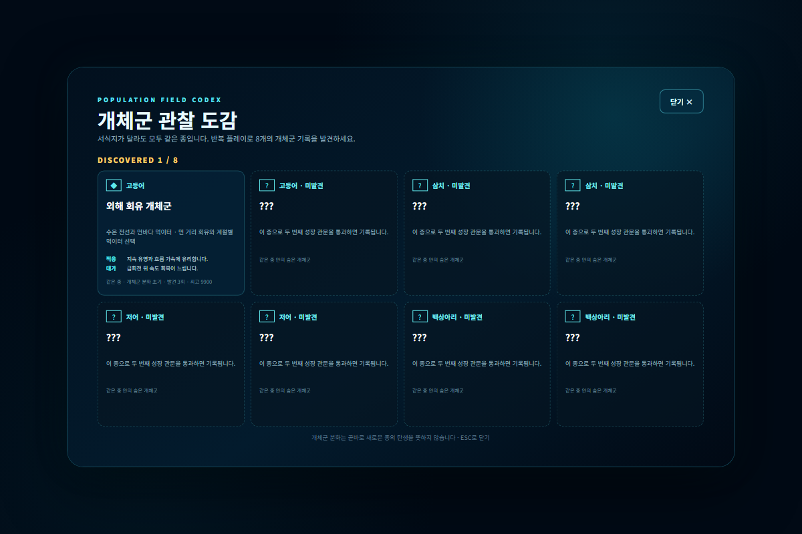
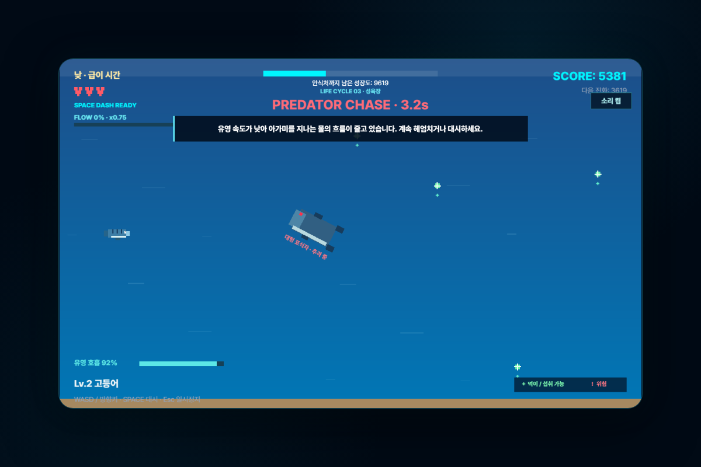

# The Blue Journey

### [🎮 게임 바로 실행](https://jh1011.github.io/The-Blue-Journey/game/)

[프로젝트 소개 페이지](https://jh1011.github.io/The-Blue-Journey/) · [소스 코드 보기](https://github.com/jh1011/The-Blue-Journey)

## Featured project

**치어에서 번식까지, 해양 생태를 직접 플레이하며 배우는 2D 생존 교육 게임**입니다.

해양 생태 교육 데모로 시작해 OpenAI 게임 해커톤 출품을 준비하면서 생존 시스템, 포식자 이벤트, 개체군 관찰 도감, 생애주기 연출을 확장했습니다. 설명을 읽는 교육보다 **생태적 특징을 직접 조작하고 선택의 결과를 경험하는 플레이**를 목표로 했습니다. 현재도 피드백을 반영해 개선 중인 플레이어블 빌드입니다.

### My role

- **2인 팀 프로젝트 리드 · 기여도 약 90%**
- 게임 콘셉트, 생애주기 진행 구조, 핵심 시스템 및 UI/UX 기획
- Codex·Grok 등 AI 코딩 도구를 활용한 Phaser/TypeScript 구현, 기능 요구사항 정의 및 결과 검토
- 조작감·사운드·밸런스 개선, 브라우저 플레이테스트 및 통합 QA
- 팀원은 플레이테스트와 오류·완성도 검수를 담당했으며, 피드백을 개선 과제로 정리해 반영

## Core gameplay · 어떻게 플레이하는가?

**먹이를 찾고 → 위험을 피하고 → 성장하며 → 서식지에 도달해 번식하는** 생존 루프를 중심으로 설계했습니다.

| 핵심 시스템 | 플레이 방식과 설계 의도 |
| --- | --- |
| **FLOW · 유영 가속** | 같은 방향으로 일정 시간 유영하면 속도가 상승하고, 급회전하면 일부를 잃습니다. 이동 방향을 스스로 판단하는 조작감을 제공합니다. |
| **먹이 콤보 · Schooling Fever** | 짧은 시간 안에 먹이를 연속으로 섭취하면 점수 배율이 상승합니다. 무리 먹이를 추적하는 보상 구간으로 먹이 탐색의 재미를 강화했습니다. |
| **LIFE · 생존 판단** | 피격·회복·실패 조건을 통해 먹이를 얻는 보상과 위험을 피하는 판단 사이에 긴장감을 만들었습니다. |
| **능동 포식자 이벤트** | 경고 후 제한된 시간 동안 포식자가 추격합니다. 위험을 미리 읽고 회피하면 생존 보상을 얻을 수 있습니다. |
| **개체군 선택 · 관찰 도감** | 어종과 개체군의 서로 다른 조건을 선택하고, 발견 기록을 브라우저에 저장해 반복 플레이의 목표로 연결했습니다. |

## Ecological design · 생태학적 특성을 게임 규칙으로

이 게임의 출발점은 **어류의 생태 지식을 게임 속 선택과 행동으로 바꾸는 것**이었습니다. 생태학적 특징에서 착안하되, 실제 생태계를 정밀하게 재현하는 연구용 시뮬레이터가 아니라 교육과 플레이를 위한 게임 규칙으로 단순화했습니다.

| 생태학적 모티브 | 게임 속 반영 |
| --- | --- |
| **어류 생애주기** | 부화 → 치어기 → 성육장 → 성어기 → 산란의 단계에 따라 성장과 목표가 달라집니다. |
| **어종별 행동·생리 차이** | 4종 어류의 특성 차이를 **유영 속도, 호흡, 야간 행동** 등 플레이 규칙에 반영했습니다. 단순히 외형만 바뀌는 캐릭터가 아니라 서로 다른 생존 조건을 경험하도록 설계했습니다. |
| **서식지와 개체군의 차이** | 어종별 외해형·연안형 등 총 8개 개체군의 이점과 대가를 선택하도록 구성해, 서식환경에 따른 생존 전략의 차이를 게임화했습니다. |
| **먹이·포식 관계와 인위적 위험** | 먹을 수 있는 대상과 위험 요소를 크기·색상·경고로 구별하고, 포식자와 폐그물 등 위험을 회피하도록 구성했습니다. |
| **관찰을 통한 학습** | 플레이 중 발견한 어종과 개체군 정보를 관찰 도감에 저장해, 반복 플레이가 생태 지식의 수집으로 이어지도록 했습니다. |

### Species-specific gameplay · 어종마다 다른 생존 방식

4종 어류의 차이를 외형뿐 아니라 **이동 속도, 호흡, 먹이 획득, 포식·회피 방식**으로 표현했습니다. 어류 생태의 특징을 게임 규칙에 맞게 단순화한 설계입니다.

| 어종 (게임 표기) | 생태학적 착안점 | 실제 게임에 반영한 플레이 특성 |
| --- | --- | --- |
| **고등어** | 빠른 유영, 무리 생활, 유영에 따른 아가미 환기 | 기본 속도 **420**, 대시 배율 **2.4**. 먹이 섭취 시 성장 보상을 강화하고, 저속 상태가 오래 지속되는 상황을 주의하도록 설계했습니다. |
| **삼치** | 빠른 회유성 유영과 유영을 통한 아가미 물 흐름 | 기본 속도 **480**, 대시 배율 **2.6**으로 4종 중 가장 빠른 이동 특성을 부여했습니다. **야간 자동 하강이 없는** 규칙도 적용했습니다. |
| **저어** (게임 내 표기) | 해저 가까이 생활하는 가자미류의 체형·위장 전략 | 기본 속도 **270**으로 이동은 느리지만, **해저에 가까이 붙으면 위장 점수 보너스**를 받도록 했습니다. |
| **백상아리** | 유영하며 아가미에 물을 통과시키는 호흡 방식, 상위 포식자의 먹이 관계 | 기본 속도 **288**. 지속 유영에 따른 호흡 조건을 반영했으며, **일부 포식자는 먹을 수 있지만 폐그물은 피해야 하는** 별도 생존 규칙을 적용했습니다. |

※ 속도와 대시 배율은 **게임 내부 밸런스 설정값**이며 실제 어류의 측정된 유영 속도가 아닙니다. 특히 고등어·삼치의 호흡과 서식 행동은 교육용 게임에 맞춰 단순화한 표현입니다. 현재 게임에서 **'저어'로 표시된 캐릭터는 가자미류형 해저 생활 어류**를 모티브로 설명한 것으로, 특정 종의 학명에 대응하는 명칭이라고 주장하지 않습니다.

## Why these systems exist

플레이테스트에서 발견한 문제를 **관찰 → 판단 → 구현 → 검증**의 과정으로 개선했습니다.

| 플레이에서 발견한 문제 | 판단과 구현 |
| --- | --- |
| 실패 위험이 없어 긴장감이 약함 | LIFE, 피격·회복·실패 조건 추가 |
| 반복 구간이 같은 패턴으로 흐름 | 경고 후 5초간 추격하는 포식자 이벤트 추가 |
| 엔딩 후 다시 플레이할 이유가 없음 | 4종 어류·8개 개체군 선택과 관찰 도감 저장 연결 |
| 빠른 장애물로 위험을 읽기 어려움 | 속도·충돌 범위 조정, 경고·색·사운드 피드백 분리 |

즉시 보상은 **FLOW와 먹이 콤보**, 한 판의 긴장은 **LIFE와 포식자**, 재도전 동기는 **개체군 선택과 관찰 도감**으로 설계했습니다.

### Tech & AI workflow

`Phaser 4.2.1` · `TypeScript 6` · `Vite` · frame-independent movement · `localStorage`

기획과 문제 정의, 기능 우선순위 결정 및 플레이 검증은 직접 수행했고, 코드 구현에는 AI 코딩 도구를 적극 활용했습니다. 구현 전 변경 계획을 검토하고, 실행 결과와 팀원 피드백을 바탕으로 수정 범위를 구체화해 반복 개선했습니다.

## Local preview

저장소 루트에서 정적 웹 서버를 실행한 뒤 `index.html`을 엽니다. 플레이 가능한 빌드는 `game/`에 포함되어 있습니다.
